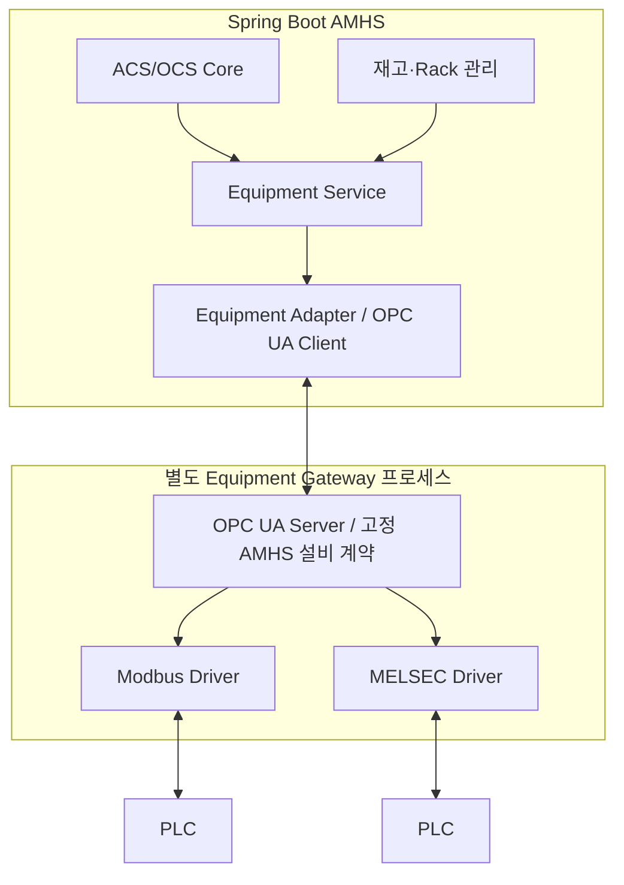

# AMHS 설비 OPC UA 계약 v1

결정일: 2026-10-03. 근거: 사용자 합의에 따른 **신규 설계**.
상태: 책임 경계와 논리 계약 정의 완료. OPC UA Client/Server, PLC 드라이버, NodeSet 및 실장비 검증은 **미구현**이다.
이 문서의 식별자·상태·명령은 본 프로젝트의 공통 설비 계약이다. 설비별 통신 규격과의 변환은 Equipment Gateway에서 담당한다.

## 1. 구조와 범위

- AMHS에 포함되는 Equipment Adapter는 OPC UA Client다. Gateway는 별도 배포·재시작 가능한 프로세스다. 같은 PC에 설치해도 책임 경계는 유지한다.
- AMHS는 본 계약의 논리 설비·포트·명령만 사용한다. PLC 주소, 레지스터, 비트, 워드 순서, 제조사별 핸드셰이크 분기를 갖지 않는다.
- Gateway가 PLC별 차이를 흡수한다. 기존 번호 기반 IO 배열·번호 참조 작업 코드 방식은 Gateway의 드라이버 설정에 둔다. 범용 규칙 엔진이나 시퀀스 편집기를 도입하지 않는다.
- 차량 VDA/MQTT·TCP와 MES REST/MCS HSMS·SECS는 별도 경로다. OPC UA 설비 경계에 포함하지 않는다.
- Rack은 재고 기록 범위다. 설비 내부 셀을 추측하거나 외부 WMS·차량 미들웨어를 이 Gateway에 통합하지 않는다.

| 영역 | 책임 | 경계 밖 책임 |
|---|---|---|
| ACS/OCS Core | 반송 원장, 배차·경로·Traffic, 차량 지시, 포트 예약 | PLC 비트 제어 |
| Equipment Service | 설비/차량 양쪽 준비 대조, 인수도 조건, 완료 근거 연결, 타임아웃·복구 판단 | 설비 내부 동작 순서 |
| Equipment Adapter | 공통 타입 변환, OPC UA 세션·구독·조회, 송신 결과·신선도 전달 | 업무 완료를 통신 성공에서 추정 |
| Gateway | PLC 폴링/명령 변환, 공통 상태 생성, 명령 중복 방지·결과 원장, 설비별 핸드셰이크 | 배차·경로·재고 셀 추정 |
| PLC | 내부 동작·인터록·현장 안전 제어 | AMHS 작업 우선순위 |

## 2. v1 지원 범위와 호환성

v1은 설비 포트의 인수도 준비·취소·종료와 상태 조회를 지원한다. 설비 리셋, 강제 동작, 셀 직접 입출고, 임의 PLC 쓰기는 v1에 넣지 않는다.

- `contractVersion`은 major.minor다. major 불일치 또는 필수 기능 누락 시 제어를 시작하지 않는다.
- `capabilities`는 정의된 기능 이름의 집합이다: `HANDOVER_TO_EQUIPMENT`, `HANDOVER_FROM_EQUIPMENT`, `CARRIER_ID_READ`.
- 인수도를 지원하면 명령 조회·취소 조건 판정·완료 근거·재접속 복구는 필수다. 지원하지 않는 기능은 추정하거나 우회하지 않는다.
- minor 추가는 기존 필드 의미를 바꾸지 않는 선택 기능만 허용한다. 알 수 없는 선택 기능은 무시하고, 알 수 없는 명령은 거부한다.
- 설비마다 명령 이름·필드 의미를 바꾸지 않는다. v1로 표현 불가능한 설비는 미지원으로 표시하고 공통 계약을 먼저 개정한다.
- OPC UA 네임스페이스 URI는 `urn:amhs:equipment:1`로 정한다. NamespaceIndex 숫자는 연결 시 NamespaceArray에서 찾으며 고정하지 않는다.
- v1 식별자는 `siteCode`, `equipmentCode`, `portCode` 문자열이다. 사이트 내 설비, 설비 내 포트가 각각 유일하고 재시작 후에도 유지된다. AMHS 내부 DB ID를 회선 식별자로 사용하지 않는다.

## 3. OPC UA 노출 형태

논리 경로는 `Objects/AMHS/Equipment/{equipmentCode}`다. 사이트는 endpoint의 식별 정보와 대조한다.
숫자 NodeId와 binary encoding ID는 구현 시 버전 관리되는 NodeSet에서 확정한다. 따라서 이 문서만으로 회선 상호운용 구현이 완료된 것은 아니다.

| 항목 | 접근 | 역할 |
|---|---|---|
| `Identity` | 읽기 | siteCode, equipmentCode, contractVersion, capabilities |
| `Snapshot` | 읽기·구독 | 설비와 포트의 한 시점 상태를 담는 단일 구조체 |
| `ReadSnapshot()` | Method | 현재 Snapshot과 같은 구조체를 일관된 한 번의 관측으로 반환 |
| `SubmitCommand(CommandRequest)` | Method | 영속 접수 또는 거부를 즉시 반환. 물리 동작 완료까지 호출을 붙잡지 않음 |
| `GetCommandResult(commandId)` | Method | 명령 접수·실행·결과 조회. 알 수 없는 ID는 NOT_FOUND |
| `GetHandover(transferId)` | Method | 인수도 상태와 완료 근거 조회. 알 수 없는 ID는 NOT_FOUND |

타입은 이름 있는 OPC UA Structure/Enum으로 정의하고 NodeSet을 Client/Server가 공유한다. 임의 JSON·태그 사전·여러 쓰기 가능한 변수에 명령을 나누어 기록하는 인터페이스는 사용하지 않는다. Snapshot은 Client가 쓸 수 없다.

## 4. 상태와 관측 유효성

| 필드 | 논리 타입 | 규칙 |
|---|---|---|
| gatewayBootId | Guid | Gateway 기동마다 변경. 바뀌면 Client는 구독·스냅샷·미완료 작업 재동기화 |
| ledgerId | Guid | 영속 명령 원장의 세대. 정상 재시작에서는 유지, 원장 재생성 시 변경 |
| snapshotSequence | UInt64 | 같은 boot 내 단조 증가. PLC 관측/통신 상태 갱신 시 증가 |
| observedAt | UTC DateTime | PLC 관측을 취득한 시각. 캐시 재전송으로 갱신하지 않음 |
| plcConnection | Enum | CONNECTED / DISCONNECTED / UNKNOWN |
| controlMode | Enum | AUTO / MANUAL / UNKNOWN |
| equipmentState | Enum | IDLE / BUSY / FAULT / UNKNOWN |
| ports | PortSnapshot[] | 아래 포트 상태. 설비 Snapshot에 함께 포함 |

PortSnapshot은 `portCode`, `enabled`, `readyToReceive`, `readyToSend`, `carrierPresence`, `carrierCode`, `transferId`, `transferState`, `faultCode`를 포함한다.
준비값은 TRUE/FALSE/UNKNOWN, 화물 유무는 PRESENT/ABSENT/UNKNOWN이다. carrierCode는 모르면 비워 두며 요청 화물 ID를 읽은 ID처럼 복사하지 않는다. transferId와 faultCode도 해당하지 않으면 비운다.

- 데이터의 OPC UA StatusCode, SourceTimestamp와 공통 관측 상태를 함께 판정한다. Good 품질·PLC 연결·신선도·명령별 준비 조건이 모두 충족되어야 신규 제어가 가능하다.
- OPC UA 세션 연결과 PLC 연결은 별개다. Gateway가 살아 있어도 PLC가 끊기면 ready를 정상으로 유지하지 않는다.
- 변경이 없는 설비도 PLC 관측은 주기적으로 갱신한다. 구독 keep-alive 수신만으로 observedAt을 새로 만들지 않는다.
- 일부 포트의 관측만 실패하면 해당 필드를 UNKNOWN/불량 품질로 표시한다. 구현에서 필드별 품질을 제공하지 못하면 전체 Snapshot을 불량으로 처리한다.
- 불량/오래된 데이터는 마지막 값과 함께 비유효 상태로 표시한다. 빈 포트·빈 재고로 바꾸지 않는다.
- 샘플링·전송·신선도·준비·물리 인수도 제한 시간은 배포 설정으로 분리한다. 임의 공통 기본값으로 실장비를 가동하지 않고 PLC 주기·네트워크·기계 시간을 확인해 정한다. 설비별 검증값은 비공개 설정이다.

## 5. 명령 계약

CommandRequest 필수 필드: `contractVersion`, `commandId`(Guid), `transferId`(Guid), `siteCode`, `equipmentCode`, `portCode`, `kind`, `direction`, `issuedAt`, `acceptBefore`(UTC), `requestedBy`, `reason`.
`carrierCode`는 선택값이며 화물 식별이 필요한 작업은 AMHS와 Gateway 모두 누락을 거부한다. direction은 TO_EQUIPMENT / FROM_EQUIPMENT다.
requestedBy는 업무 감사 정보이며 OPC UA 인증 주체를 대체하지 않는다. AMHS는 요청 전체와 ID를 송신 전에 영속 기록한다.
transferId는 AMHS가 포트별 인수도 한 건에 발급한다. 출발 설비에서 인수하는 건과 도착 설비에 인계하는 건은 서로 다른 transferId를 사용하며, AMHS 반송 원장이 두 건을 연결한다. 같은 인수도의 PREPARE/CANCEL/CLOSE는 transferId를 유지하고 각각 별도 commandId를 사용한다.

| kind | 목적 | 성공 근거 |
|---|---|---|
| PREPARE_HANDOVER | 지정 방향의 포트 준비와 transfer 선점 | PLC가 해당 인수도의 준비 상태를 확인. 이 성공은 화물 이동 완료가 아님 |
| CANCEL_HANDOVER | 물리 인수도 시작 전 준비 철회 | PLC가 준비 해제를 확인하고 화물 이동 미발생을 확인 |
| CLOSE_HANDOVER | 확인된 인수도의 핸드셰이크 종료·자원 정리 | 동일 transfer가 TRANSFERRED이며 설비 종료 응답 확인. 완료를 강제로 만드는 명령이 아님 |

- 같은 transferId의 설비·포트·방향·화물 연결은 최초 접수 후 불변이다. 후속 명령이 다른 연결을 제시하면 거부한다.
- 포트에는 열린 transfer 한 개만 둔다. 공통 내부 자원을 공유하는 포트들의 배타 제어는 Gateway/PLC가 추가 보장한다.
- CANCEL/CLOSE는 기존 transfer의 제어 명령이다. 열린 transfer가 있다는 이유로 그 제어 명령까지 BUSY로 막지 않는다. 한 transfer에 대해 충돌하는 명령은 순서대로 판정한다.
- 준비됐더라도 차량 동작을 시작할지는 AMHS가 차량 위치·점유·양쪽 준비를 대조해 결정한다. PLC의 물리 인수도 시작 신호는 현장 설비의 인터록 조건에 따른다.
- 물리 동작 시작 후 취소 요청은 `CANNOT_CANCEL_IN_PROGRESS`로 거부한다. v1에는 원격 비상정지/강제 반전이 없다.

## 6. 접수·실행·물리 완료의 분리

명령 접수 응답은 `commandId`, `decision`(ACCEPTED / REJECTED), `reasonCode`, `recordedAt`이다. ACCEPTED는 실행 의도와 중복 판정 자료를 영속 저장했음을 뜻한다.
명령 결과는 `commandId`, `transferId`, `state`, `resultCode`, `updatedAt`, `evidenceSequence`를 반환한다.
명령 상태는 ACCEPTED → EXECUTING → SUCCEEDED / FAILED이며, 실행 결과를 확정할 수 없으면 IN_DOUBT다. REJECTED도 동일 ID 조회가 가능하도록 남긴다.
IN_DOUBT는 관측 근거 재대조 또는 감사 기록이 남는 운영자 복구 판단으로 해소한다. 시간 초과만으로 FAILED나 성공으로 바꾸지 않는다.

인수도 상태는 별도다: PREPARING → READY → TRANSFERRING → TRANSFERRED → CLOSED.
시작 전 취소가 확인되면 CANCELLED, 실패/모순/재시작으로 화물 위치가 불명확하면 RECOVERY_REQUIRED다.
Gateway의 인수도 관측 결과에는 transferId, direction, 관측 시각·순서, PLC 확인 근거 코드, 화물 유무·식별 결과를 영속 기록한다. 재접속 시 GetHandover로 다시 읽을 수 있어야 한다.

AMHS의 반송 완료는 일치하는 transferId의 설비 근거와 차량 적재/하역 근거를 대조해 결정한다. 설비 준비 완료, Method 호출 성공, ACCEPTED, OPC UA Publish 확인을 반송 완료로 사용하지 않는다.
Gateway의 TRANSFERRED는 설비 쪽 관측 확정이며, 차량 쪽 근거까지 대신하지 않는다. 양쪽이 모순되면 복구 대기로 남긴다.
설비 인계 완료만으로 내부 셀을 지정하지 않는다. 재고는 포트 인계까지 기록하고 셀은 별도의 검증된 관측으로만 확정한다.

## 7. 중복 방지·단절·재시작

1. Gateway는 인증된 제어 주체와 commandId를 키로 요청 의미 필드 전체를 비교한다. 동일 ID·동일 내용이면 원래 결과를 반환하고 PLC에 다시 지시하지 않는다. 동일 ID·다른 내용이면 `COMMAND_ID_CONFLICT`다.
   제어 주체는 인증정보에 연결된 안정된 논리 식별자다. 인증서 갱신으로 중복 판정 범위가 바뀌어서는 안 된다.
2. Client의 전송·호출 타임아웃은 결과 불명이다. 새로운 ID로 재발행하지 않고 같은 commandId와 transferId를 조회한다. 명백한 미송신과 실행 실패를 구분한다.
3. PLC 쓰기와 Gateway DB 커밋은 원자적이라고 가정하지 않는다. 영속 실행 의도 기록 → PLC 전달 → 관측 결과 기록 사이에서 재시작하면, PLC가 동일 작업임을 입증하지 못하는 한 IN_DOUBT/RECOVERY_REQUIRED로 남긴다.
4. Gateway는 OPC UA 단절이나 AMHS 재시작만으로 PLC 상태·작업·포트 선점을 초기화하지 않는다. 연결이 끊겨도 로컬 인터록은 PLC가 유지한다.
5. 재연결은 인증·버전 확인 → 새 구독 설정 → 일관된 Snapshot 조회 → commandId/transferId 대조 순서다. 같은 boot에서 중복·과거 sequence를 버리고, boot 변경·누락·queue overflow는 전체를 재조회한다.
6. `NOT_FOUND`는 미실행 증명이 아니다. ledgerId 변경 또는 원장 누락 시 자동 재실행하지 않고 복구 대상으로 둔다.
7. 열린 명령/transfer는 보관 기간으로 삭제하지 않는다. 종결 결과와 중복 판정 자료는 합의된 재시도·감사 보관 기간을 만족해야 한다. 보관 기간 이후에도 과거 명령이 다시 실행되지 않게 acceptBefore를 검사한다. 기존 ID 조회는 만료 후에도 보관 중인 결과를 반환한다.
8. acceptBefore는 신규 접수 마감이며 물리 동작 중단 시각이 아니다. 시계 동기화와 허용 오차가 검증되지 않으면 신규 제어를 중지한다. 만료/불명 명령의 새 ID 발급은 현장 결과 확인 후 별도 복구 결정으로만 수행한다.

v1은 설비당 활성 AMHS 제어 주체 하나다. 인증된 writer를 고정하고 그 외 주체의 SubmitCommand는 거부한다. 자동 이중화·writer 전환은 범위 밖이며 향후 소유권 fencing 계약 없이 추가하지 않는다.

## 8. 오류·보안·설정

공통 거부 코드는 VERSION_MISMATCH, UNSUPPORTED_COMMAND, UNKNOWN_TARGET, NOT_AUTHORIZED, COMMAND_ID_CONFLICT, EXPIRED, PORT_BUSY, NOT_READY, MANUAL_MODE, STALE_DATA, PLC_DISCONNECTED, CANNOT_CANCEL_IN_PROGRESS다.
예상 가능한 업무 거부는 공통 응답에 담고 OPC UA 세션/서비스 실패와 구분한다. PLC 상세 진단은 Gateway 로그에 두고 AMHS에는 공통 코드·추적 ID를 전달한다.

- 실제 제어 endpoint는 SignAndEncrypt와 허용된 인증서·권한을 사용한다. 인증서 오류 시 보안을 낮춰 재접속하지 않는다. 읽기 주체와 제어 주체를 구분한다.
- AMHS 설정: endpoint, 신뢰 인증서 참조, 인증정보 참조, 사이트/설비/포트 식별, 계약 버전, 신선도·시간 제한.
- Gateway 설정: PLC 접속, 드라이버 종류, IO 배열 번호·참조 코드 매핑, 핸드셰이크 매핑, 공통 자원 그룹, 로컬 기록 보존.
- 인증서 개인키·암호·실제 PLC 주소·현장 IO 매핑은 소스/공개 문서에 넣지 않는다.
- Gateway 교체·매핑 변경은 진행 transfer와 명령을 정리하고 설정 버전을 감사 기록한 후 적용한다.

## 9. 기존 코드 전환과 구현 완료 기준

현 설정의 설비 NONE/MELSEC/MODBUS는 현재 구현 사실로 남는다. 목표 구조에서는 MELSEC/MODBUS 설정을 Gateway로 옮기고, AMHS에는 OPC UA 연결과 논리 설비 계약을 둔다. 이번 문서 작성은 데이터 마이그레이션이나 실행 설정 변경을 수행하지 않는다.
OPERATION의 NONE/수동 설비는 자동 완료하지 않는다. 실제 OPC UA Client/Server 통신 경로는 OPERATION 전용이다.

### SIMULATION 실행 경계 — 구현 반영

SIMULATION은 OPC UA Server를 요구하지 않는 내부 가상 설비 경로를 사용한다. 등록된 논리 설비·포트와 차량 경로를 사용하지만, 실제 설비 사양·PLC IO·통신·준비 관측은 읽거나 요구하지 않는다. 가상 ERROR/OFFLINE/BUSY도 접수·할당을 차단하지 않는다.

- Equipment 화면에서 가상 상태와 시뮬레이션 사용·콜 허용을 변경한다. 운전 권한이 필요하며 설비 구성 수정 권한과 분리한다.
- 설비 구성의 사용금지, 시뮬레이션 사용금지, 콜금지는 유지한다. 금지 중 일반 상태 변경·신규 접수·할당은 거부한다. 금지 해제 자체는 가능하다.
- 차량이 출발 포트에 도착 → 가상 인수 시작 → 차량 적재 확정 → 목적지 이동 → 가상 인계 시작 → 하역 확정 → 완료 순서로 진행한다. 가상 관측 근거는 반송 이력에 남긴다.
- 인수/인계 전후 각 단계에서 금지를 재확인한다. 도중 금지되면 그 포트에서 작업·화물 위치를 유지하며 대기하고, 해제 후 이어간다. 포트 이동 경로와 Traffic, 차량 사용·할당 가능 여부, 차량 종류, 중복 작업·점유 방지는 그대로 적용한다.
- 가상 상태는 별도 저장하며 OPERATION에서 읽어 실제 관측처럼 사용하지 않는다. OPERATION은 가상 설비 변경 API를 거부하고 시뮬레이터의 이동·인수도 틱을 진행하지 않는다.
- 이번 구현은 내부 시뮬레이션 경로다. 실제 OPC UA Client/Server와 NodeSet 구현 완료를 뜻하지 않는다.

다음은 설계 검증 기준이며 **아직 실행한 시험 결과가 아니다**.

| 시나리오 | 반드시 확인할 결과 |
|---|---|
| 같은 명령 재전송·내용 변경 | 재실행 없음 / 다른 내용 거부 |
| 접수 직후 응답 유실 | ID 조회로 복구, 새 ID 발행 없음 |
| PLC 전달 전후 Gateway 재시작 | 증거 없는 재전송·완료 판정 없음 |
| Gateway 정상·PLC 단절 | 상태 비유효, 신규 제어 금지 |
| 구독 누락·부분 관측 실패·복귀 | Snapshot 재대조, 일부 성공으로 전체 정상 표시하지 않음 |
| 포트 동시 준비·물리 진행 중 취소 | 단일 선점, 부적절한 취소 거부 |
| PREPARE 성공 | READY만 성립, 화물 이동 완료 아님 |
| 인수도 근거 일치/모순 | 일치 시 진행, 모순 시 복구 대기 |
| 설비 인계 완료 | 내부 셀 위치를 생성하지 않음 |
| major 불일치·지원 기능 누락·권한 오류 | 제어 시작 거부 |
| 원장 유실·만료 명령 | 자동 재실행하지 않음 |

구현 순서는 공통 타입/NodeSet → 모의 OPC UA Server·계약 시험 → Client 연결·재동기화 → Gateway 단일 PLC 드라이버 → 실제 인수도 검증 → 다른 드라이버 확장이다.
NodeSet의 정확한 인코딩, SDK 선택, PLC별 신호 대응과 시간 설정은 구현/현장 검증에서 확정한다. 설계 문서 완료를 실장비 연동 완료로 표시하지 않는다.

## 10. 표준과 본 설계의 구분

OPC UA는 정보 모델, Method 호출, 구독·조회 및 값의 품질/시각을 제공한다. 위 명령·상태·중복 방지·인수도 규칙은 AMHS 자체 계약이며 OPC UA 표준이 자동으로 보장하는 동작이 아니다.

- [OPC Foundation: OPC UA 개요](https://opcfoundation.org/about/opc-technologies/opc-ua/)
- [OPC UA Part 4: Call](https://reference.opcfoundation.org/specs/OPC-10000-4/5.12.2.1)
- [OPC UA Part 4: DataValue](https://reference.opcfoundation.org/specs/OPC-10000-4/7.11)
