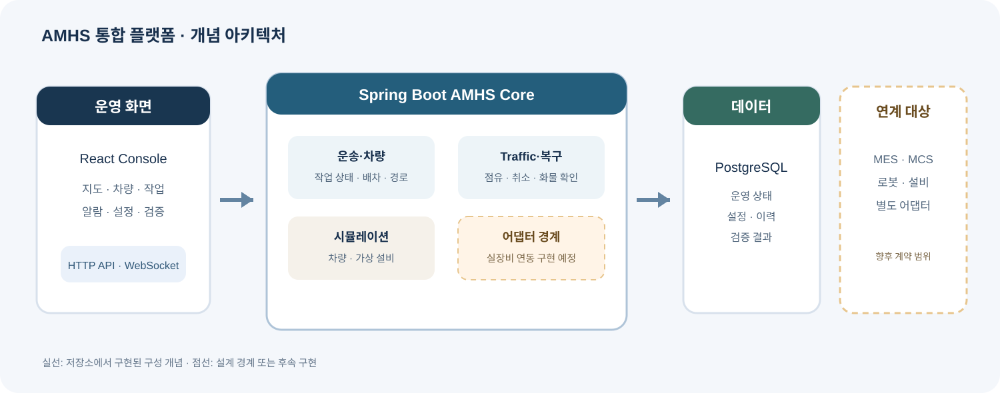
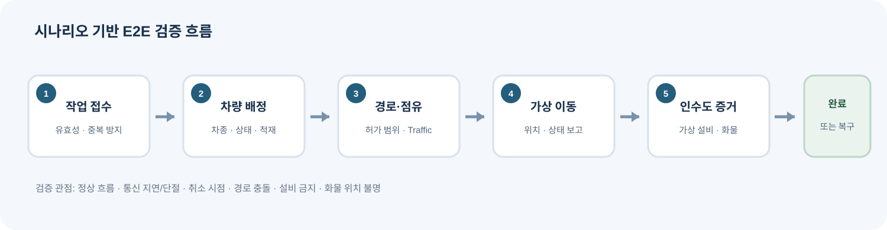

# AMHS Integration Platform Design Overview

## Purpose

This note describes the design intent and current implementation boundary of a personal AMHS integration platform. It contains no customer, employer, plant, legacy project, production address, or equipment-specific identifier. The diagrams are conceptual views of the platform and are not a claim that every shown interface is implemented.

## System boundary

The web client uses versioned HTTP APIs for configuration and operation views. A Spring Boot service owns the transport-order lifecycle, fleet state, map and route decisions, traffic reservations, and the in-process simulation. PostgreSQL stores operational records and configuration. Vehicle and equipment integration sit behind adapters so the core can reason in terms of stable domain commands and reported outcomes.

In simulation mode, the server executes vehicle movement and equipment handover against virtual state. In operation mode, virtual state is not treated as a report from real equipment. The real-device adapter and its inbound acknowledgement path remain implementation work.

## Design decisions

- A transport request has one explicit lifecycle. Acceptance, assignment, movement, handover evidence, recovery, and terminal status remain distinguishable.
- A vehicle receives only the route portion it is authorized to occupy. Traffic reservations represent permission to use shared track resources and are released as the vehicle advances or work is resolved.
- Vehicle type and network are part of eligibility and route choice. OHT rail movement and AGV floor movement share transport concepts while retaining separate topology constraints.
- Simulation exercises the same order, vehicle-eligibility, routing, and traffic decisions as operation. Simulated equipment state and simulated handover evidence stand in for sensors only in simulation mode.
- Service exclusion prevents new transport work assignment. It does not by itself prohibit home, charging, yielding, or other movement policies. OHT maintenance-zone behavior and AGV home-return behavior remain distinct policies.
- A recovery record describes an operator's confirmed carrier location. It does not physically move a carrier or silently rewrite a simulated vehicle's load state.

## Verification intent

The platform is developed around reproducible end-to-end scenarios: accept a request, validate eligibility, route and reserve resources, execute a movement, perform a virtual equipment handover, and either complete or enter a recoverable state. Fault cases include unavailable devices, stale status, route conflict, cancellation while movement is outstanding, and uncertain carrier location.

The repository records completed implementation and tests separately from design decisions and planned adapter work. No real-device, factory, or safety-certification result is implied by the simulator.
